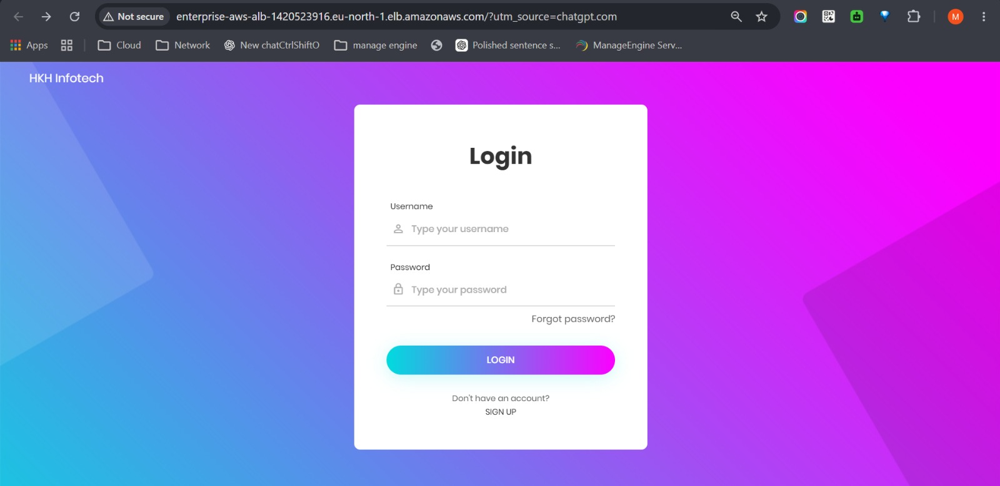
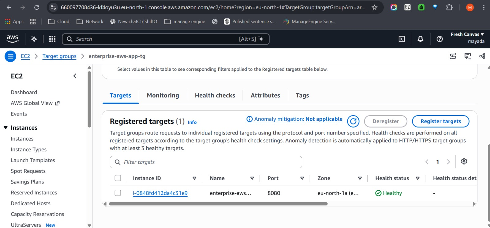
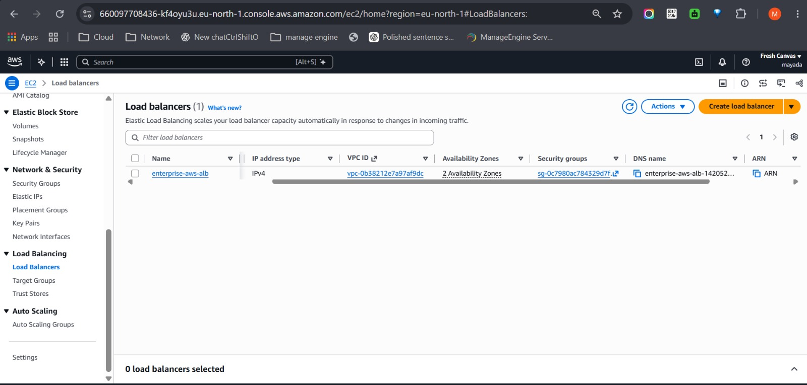

# AWS Enterprise Application Deployment

## Project Overview
A multi-tier Java web application deployed on AWS using Terraform and Ansible.

## Architecture
- Amazon VPC with public and private subnets
- Internet Gateway and NAT Gateway
- Security Groups
- Application Load Balancer (ALB)
- EC2 instances hosting the application and supporting services

## Technologies
- AWS
- Terraform
- Ansible
- Linux
- Java / Spring Boot
- MariaDB
- RabbitMQ
- Memcached
- Elasticsearch

## Repository Structure
- `terraform/` - AWS infrastructure as code
- `ansible/` - Configuration management and deployment
- `Screenshots/` - Deployment evidence

## Deployment
Infrastructure was provisioned using Terraform, followed by Ansible configuration and application deployment.

The application was successfully accessed through the Application Load Balancer, and its registered target was verified as healthy.

## Screenshots

### Application Login Page


### Healthy Target Group


### Application Load Balancer


## Cleanup
After project validation, Terraform can destroy the provisioned AWS resources:

```bash
cd terraform
terraform destroy
eof
